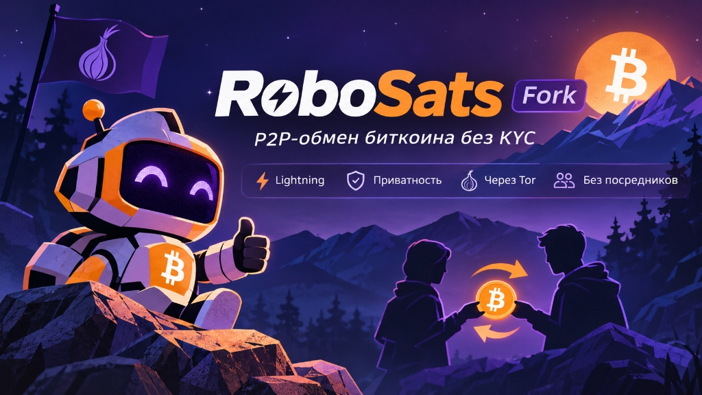

<div align="center">
  

  # RoboSats Fork — P2P Bitcoin Exchange without KYC
  
  [](https://github.com/Garrysoon/robosats/releases)
  [](https://github.com/Garrysoon/robosats/blob/main/LICENSE)
  [](https://github.com/Garrysoon/robosats)
  [](#security-audit--improvements-in-this-fork)
  [](https://simplex.chat/contact#/?v=1-2&smp=smp%3A%2F%2F0YuTwO05YJWS8rkjn9eLJDjQhFKvIYd8d4xG8X1blIU%3D%40smp8.simplex.im%2FyEX_vdhWew_FkovCQC3mRYRWZB1j_cBq%23%2F%3Fv%3D1-2%26dh%3DMCowBQYDK2VuAyEAnrf9Jw3Ajdp4EQw71kqA64VgsIIzw8YNn68WjF09jFY%253D%26srv%3Dbeccx4yfxxbvyhqypaavemqurytl6hozr47wfc7uuecacjqdvwpw2xid.onion&data=%7B%22type%22%3A%22group%22%2C%22groupLinkId%22%3A%22hWnMVPnJl-KT3-virDk0JA%3D%3D%22%7D)
  [](https://njump.me/nprofile1qqsyx53h3h7ec4fwlspjq0kqec5gv54t7rc48xdtq6q4y94wsw4fnjqsg3jtv)
</div>

RoboSats is a simple, private, and non-custodial way to exchange bitcoin for national currencies. It simplifies the peer-to-peer user experience and uses Lightning hold invoices and On-chain Taproot multisig to minimize custody and trust requirements. Deterministically generated avatars help users stick to best privacy practices without sharing personal data.

---

## 🚀 Key Improvements in this Fork

This fork introduces critical security hardening, non-custodial on-chain multisig escrow, federation monitoring, and automated cryptographic arbitration:

### 1. 🛡️ On-chain 2-of-3 Taproot Multisig Escrow (`api/multisig/`)
- **Non-Custodial Architecture**: Full support for BIP-340 (Schnorr), BIP-341 (Taproot), BIP-342 (Tapscript), and BIP-386 (Miniscript Descriptors).
- **Descriptor**: `tr(coordinator/*, multi_a(2, maker/*, taker/*, coordinator/*))`.
- **Cooperative Settlement (Maker + Taker)**: Funds are released directly between peers when both parties sign, requiring **zero coordinator involvement and zero custody**.
- **Arbitration Settlement (Coordinator + Winner)**: In disputes, the coordinator co-signs with the prevailing party. The coordinator **cannot spend funds alone** (2-of-3 threshold strictly enforced).
- **Deterministic HD Derivation**: Fresh `tb1p...` / `bc1p...` addresses per order to prevent address reuse.

### 2. 📡 Federation Coordinator Health & Uptime Monitor (`api/coordinator_monitor.py`)
- **Real-Time Monitoring**: Periodic health-checks across all federation hosts (`temple`, `lake`, `bazaar`, `freeport`, `ammanaya`, `gumpellite`).
- **Metrics Tracked**: High-precision response time (RTT in ms), API availability (`/api/info/`, `/api/book/`), active order book volume, 24-hour uptime percentage, and state transition logging (`ONLINE`, `DEGRADED`, `OFFLINE`).
- **Tor SOCKS5 & Clearnet**: Native support for onion endpoints through Tor SOCKS proxy with automatic fallback.
- **CLI & REST API**: Run `python manage.py monitor_coordinators [--interval 60] [--once]` or query `GET /api/monitoring/coordinators/`.

### 3. 🏦 Automated DKIM Bank Receipt Verification (`api/dkim_verifier.py`)
- **Anti-Fraud Arbitration**: Cryptographically verifies digital signatures on bank payment notification emails (`.eml` RFC 822) against official bank DNS public keys (RSA/Ed25519).
- **Supported Banks**: Sberbank, T-Bank (Tinkoff), Alfa-Bank, Raiffeisen, VTB, and others.
- **Reference & Amount Matching**: Matches exact fiat payment amounts and unique trade payment references (`ROBO-<id>`).
- **Admin Dispute Badge**: Verified bank receipts are highlighted with a green badge in the coordinator dispute panel.

### 4. 🦹 Triangle Fraud Protections & Preimage Encryption
- **Penny Randomization**: Automatically adds a non-zero kopeck/cent offset to round fiat amounts in `take` to prevent triangle arbitrage scams.
- **Unique Payment Reference**: Enforces mandatory `payment_reference = ROBO-<id>` in chat and trade instructions.
- **Transparent Preimage Encryption (`Fernet`)**: Lightning hold invoice preimages are encrypted at rest with AES-128-CBC + HMAC-SHA256, deriving keys from `SECRET_KEY` / `PREIMAGE_ENCRYPTION_KEY`.

### 5. 🔒 P0 Concurrency & State Machine Fixes
- **F-01**: Atomic reward updates via database-level `F("earned_rewards")` expressions to prevent race conditions during concurrent dispute payouts.
- **F-03**: Strict boolean verification on hold invoice cancellations before returning collateral.
- **F-05**: Atomic Compare-And-Swap (CAS) in order finalization (`Order.transition_status`) with auto-refund for losing taker bonds.
- **API-01, API-04, API-08**: Row locking (`select_for_update`), sequential message index calculation, and history limits to prevent chat concurrency desync.

---

## 📚 Learn & Documentation

- Comprehensive guides: https://learn.robosats.org
- Coordinator setup & deployment: [/development](/development)
- Security audit report: [RoboSats Security Audit PDF](./RoboSats_Coordinator_Security_Audit.pdf)

---

## 🌐 Try It Out

- **MAIN TOR URL:** [**RoboSats**y56bwqn56qyadmcxkx767hnabg4mihxlmgyt6if5gnuxvzad.onion](http://RoboSatsy56bwqn56qyadmcxkx767hnabg4mihxlmgyt6if5gnuxvzad.onion) (Open with [Tor Browser](https://www.torproject.org/download/))
- **Coordinators Federation:** [Clients hosted by coordinators](https://github.com/RoboSats/robosats/discussions/2216)
- **Clearnet URL:** [unsafe.robosats.org](https://unsafe.robosats.org) *(Not recommended for actual trades — use Tor for privacy!)*

*Switch between Bitcoin Mainnet and Testnet in the Settings page.*

### Mobile & Desktop Apps

<div align="center">
    <a href="https://apt.izzysoft.de/fdroid/index/apk/com.robosats" target="_blank">
        
    </a>
    <a href="https://github.com/ImranR98/Obtainium" target="_blank">
        
    </a>
    <a href="https://github.com/zapstore/zapstore/releases" target="_blank">
        
    </a>
    <a href="https://github.com/RoboSats/robosats/releases" target="_blank">
        
    </a>
</div>

---

## 🛠️ How It Works

Alice wants to buy satoshis privately:
1. **Avatar Generation**: Alice generates an avatar (`AdequateAlice01`) using a private random token.
2. **Order Creation**: Alice creates a new order and locks a small hold invoice as a fidelity bond.
3. **Taking Order**: Bob sees Alice's order in the book and locks his taker bond. The contract is locked.
4. **Escrow Lock**: Bob posts the traded satoshis via Lightning hold invoice or 2-of-3 Taproot on-chain escrow. Alice submits her payout invoice/address.
5. **Private Chat**: Bob provides payment details with a unique payment reference (`ROBO-<id>`).
6. **Fiat Payment**: Alice transfers fiat and confirms payment.
7. **Settlement**: Bob confirms fiat receipt. Satoshis are released to Alice instantly.
8. **Collateral Return**: Fidelity bonds are returned in full to both compliant parties.

---

## 💻 Running the Coordinator & Monitor

```bash
# Clone the repository
git clone https://github.com/Garrysoon/robosats.git
cd robosats

# Install dependencies
pip install -r requirements.txt

# Run migrations
python manage.py migrate

# Run federation monitoring pass
python manage.py monitor_coordinators --once

# Start continuous monitor daemon
python manage.py monitor_coordinators --interval 60
```

---

## 📄 License

The Robotic Satoshis Open Source Project is released under the terms of the **AGPL-3.0 license**. See [LICENSE](LICENSE) for more details.
